# Adharsh Siby Mathew

**Software Engineer | M.Sc. Computer Science, University of Stuttgart**

Stuttgart, Germany · [LinkedIn](https://www.linkedin.com/in/adharsh-siby-mathew-463439205/) · [Email](mailto:adharshmathew3@gmail.com)

I'm a computer science master's student with more than two years of software engineering experience at Tata Consultancy Services. My professional background is in backend development, enterprise applications, and production support. My current work focuses on applied AI, document retrieval, computer vision, and dependable software systems.

I enjoy working across the stack, from designing APIs and data models to testing the behavior of systems in real conditions.

## Selected projects

**[RAG-AI](https://github.com/KnightRider242/rag-ai)** — A local-first document retrieval and question-answering backend. Implements document parsing, chunking, Ollama-based embeddings, PostgreSQL/pgvector search, and answers with source citations. Recent work adds PDF visual inspection, persisted local visual interpretations, and collection-scoped visual retrieval.  
*Python · FastAPI · PostgreSQL · pgvector · Ollama*

**[CODEBOUND — Black Forest Hackathon 2026](https://github.com/KnightRider242/anythingmcp-BlackForestHackathon)** — Extends AnythingMCP with versioned JavaScript workflows executed in isolated sandboxes. The workflows combine ERP, supplier catalogue, and shipment data while enforcing connector permissions and execution limits.  
*TypeScript/JavaScript · MCP · Docker · PostgreSQL*

**[Confidence-Aware Driver Drowsiness Detection](https://github.com/KnightRider242/DDS-CV-MS)** — An ongoing computer-vision study of temporal facial motion. Uses region-specific KLT feature tracking, Lucas–Kanade optical flow, and forward–backward error to evaluate eye, mouth, and head movement under varying tracking quality.  
*Python · OpenCV · Optical flow · Computer vision*

**[Drawing2CAD](https://github.com/KnightRider242/drawing2cad_BlackForest)** — A local-first prototype for translating technical drawing information into structured, reviewable CAD features. Separates AI interpretation from deterministic geometry generation and STEP validation through MCP tools.  
*Python · FastAPI · React · MCP · CadQuery*

**[Linux AI Development Setup](https://github.com/KnightRider242/linux-ai-dev-setup)** — Cross-distribution setup scripts for Python/AI tooling, web development environments, and local database services, with dry-run and configurable installation options.  
*Shell · Linux · Conda · Podman/Docker*

**[CodePulse API](https://github.com/KnightRider242/CodePulse.API)** — A .NET backend project for a blogging application, focused on REST API structure and application data management.  
*C# · ASP.NET Core*

## Professional experience

**Tata Consultancy Services — Systems Engineer**

Worked on enterprise application development and support, including:

- C#/.NET backend services, REST APIs, and Angular applications.
- SQL database operations, troubleshooting, and application maintenance.
- Production support, issue investigation, testing, and coordination with stakeholders.
- Windows Server, IIS, and related infrastructure tooling.

## Technical stack

My professional experience is primarily in **enterprise .NET applications, Angular, SQL, and production support**. The AI, computer vision, and developer-tooling stack below reflects my research and independent project work.

| Area | Technologies and experience |
| --- | --- |
| **Programming languages** | Python, C#, Java, TypeScript, JavaScript, SQL, PowerShell, Bash |
| **Backend & APIs** | .NET / ASP.NET Core, FastAPI, Java Spring Boot, REST APIs, Node.js |
| **Frontend** | Angular, React, HTML5, CSS3, Vite |
| **Databases & retrieval** | PostgreSQL, pgvector, SQL Server, MySQL, MongoDB, vector embeddings, semantic search |
| **AI, ML & computer vision** | OpenCV, CNNs, KLT tracking, Lucas–Kanade optical flow, DeepLabv3+, MobileNet-SSD, object detection, semantic segmentation |
| **LLM & agent tooling** | Ollama, local vision-language models, retrieval-augmented generation (RAG), Model Context Protocol (MCP) |
| **Cloud, containers & developer tooling** | Azure, Docker, Podman, Git, GitHub Actions, Linux, Conda, VS Code |
| **Enterprise systems & operations** | Windows Server, IIS, Active Directory, Group Policy, Windows Services, database maintenance, production troubleshooting |
| **Testing & quality** | pytest, API testing, automated tests, debugging, incident investigation, application support |

**Current academic focus:** Computer vision, reinforcement learning, knowledge graphs, and data-intensive systems.

## Education & publication

**M.Sc. Computer Science** — University of Stuttgart, Germany (2026–present)  
Interests include computer vision, machine learning, and software systems.

**B.Tech Computer Science and Engineering** — Amrita Vishwa Vidyapeetham, India (2019–2023)

**Publication:** *A Brief Study on Cloud Security*, IEEE International Conference on Computing, Communication and Networking Technologies (ICCCNT), 2023. [DOI: 10.1109/ICCCNT56998.2023.10307757](https://doi.org/10.1109/ICCCNT56998.2023.10307757).

## GitHub activity

These dashboards are generated from GitHub data and refreshed daily by a [GitHub Actions workflow](.github/workflows/profile-cards.yml). Their SVG files are stored in this repository, so they do not depend on third-party image servers when the profile loads.

### Overview

  <picture>
    <source media="(prefers-color-scheme: dark)" srcset="./assets/overview.dark.svg">
    
  </picture>

### Repository languages

  <picture>
    <source media="(prefers-color-scheme: dark)" srcset="./assets/languages.dark.svg">
    
  </picture>

### Contributions and streaks

  <picture>
    <source media="(prefers-color-scheme: dark)" srcset="./assets/contributions.dark.svg">
    
  </picture>

### Contribution activity over time

  <picture>
    <source media="(prefers-color-scheme: dark)" srcset="./assets/momentum.dark.svg">
    
  </picture>

Dashboard figures depend on the activity visible through GitHub. Repository languages reflect code composition, not individual proficiency. The charts are regenerated daily and can also be refreshed manually from the Actions tab.

---

Outside software, I spend time on photography, hardware projects, and travel.
